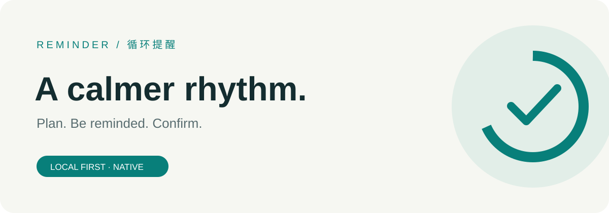
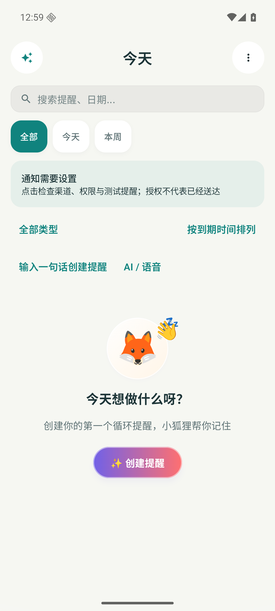
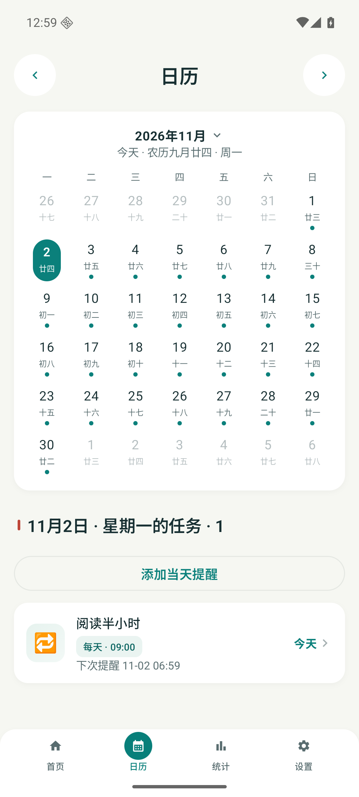
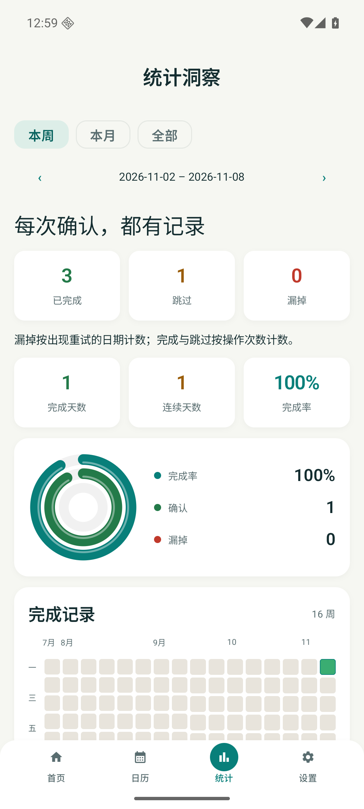
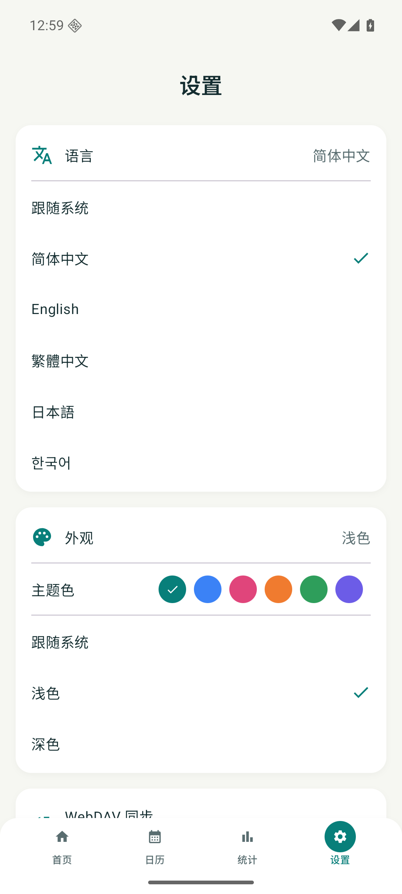

[简体中文](README.md) · [English](README.en.md) · [繁體中文](README.zh-TW.md) · [日本語](README.ja.md) · [한국어](README.ko.md)



# Reminder

**Keep what needs a confirmation in view.**

Native reminders for iOS and Android. Confirm to move to the next cycle; use your chosen retry style and intervals while a task remains unconfirmed. Local data first, optional sync.

Source **2.9.0 / 71** · development branch, not released. See Releases for public downloads.

[**Downloads & releases ↗**](https://github.com/tsumon/reminder-app-android/releases/latest) · [Other platform](https://github.com/tsumon/reminder-app-ios)

## What it does

| Capability | iOS | Android |
| :--- | :---: | :---: |
| Cycles, dates, lunar birthdays, holidays, nth-week rules | ✓ | ✓ |
| Fixed schedule / restart from completion | ✓ | ✓ |
| Gentle / persistent / important, retries and quiet hours | ✓ | ✓ |
| Complete, snooze, tomorrow, skip and undo | ✓ | ✓ |
| Search, combined type filters, due / title / priority sorting | ✓ | ✓ |
| Day agenda, week / month statistics, widgets | ✓ | ✓ |
| Offline natural language, voice, templates, configurable AI | ✓ | ✓ |
| JSON, ICS, nearby transfer, local backups, WebDAV | ✓ | ✓ |

## Start in three steps

1. Create a reminder manually or fill the editable form with a sentence, voice or a template. Review the complete rule.
2. Choose the style, recurrence anchor, retry intervals and quiet hours. Review the next three occurrences before saving.
3. Open the notification check on Home, inspect permissions and system settings, then schedule a test and lock your device.

## Running app

Only actual runtime captures are shown. Example reminders belong to an isolated test device, not default user data.

<p align="center">
  
  
</p>
<p align="center">
  
  
</p>

[Create form](docs/screenshots/runtime-2.9/create.png) · [Capture details](docs/screenshots/runtime-2.9/README.md)

## How reminders repeat

**Fixed** preserves the original schedule after a late completion; an early completion of a holiday-shifted reminder consumes its original slot. **After completion** starts a new interval from your confirmation. Existing reminders keep their policy.

**Gentle** sends one automatic alert. **Persistent** defaults to 60 → 240 → 720 → 1440 minutes, up to 5 alerts including the first, with individually editable intervals. **Important** uses only capabilities granted by the OS. Retries respect quiet hours.

Calculations use the device calendar and stored anchor timestamps. A time-zone change does not rewrite existing anchors: review the next alert. Previews assume on-time confirmation and may change with holiday data.

Completed and skipped count actions separately. Missed counts dates with retries; it does not prove notification delivery.

## Sync & recovery

Use your own WebDAV server. Conflicting edits pause for an explicit choice. Private local snapshots are saved first, and uploads retain ETag preconditions. Schema v4 merges history by stable ID and keeps deletion markers for reminders and undone records.

Upgrade both devices for full history and deletion sync. v1–v3 backups remain readable, but older clients discard the new metadata. Ancient files without stable IDs cannot reliably identify deletions. Markers do not expire; restore a deleted reminder under a new ID and keep complete v4 backups. Single-item share cards do not carry global deletions.

## Install & upgrade in place

Android 8.0+. Install an APK from the original release channel over the existing app, retaining its package and signing certificate. Do not uninstall or clear data. A source build is not a verified release-signed artifact.

## What delivery status means

Permissions and scheduled counts describe configuration, not confirmed delivery. Silent mode, Focus / Do Not Disturb, notification channels, power policies and vendor background restrictions can affect alerts. Test on a locked physical device, after reboot and in the background.

Android uses AlarmManager: exact alarms when allowed, otherwise an inexact fallback that may be delayed. WorkManager handles deferred jobs such as weekly reports.

## Build locally

JDK 17 · Gradle 8.11.1 · AGP 8.10.1 · SDK 36 · minSdk 26

```sh
./gradlew testDebugUnitTest assembleDebug lintDebug assembleDebugAndroidTest
./gradlew connectedDebugAndroidTest
```

`applicationId / namespace`: `com.reminderapp`

Release: `KEYSTORE_PATH`, `KEYSTORE_PASSWORD`, `KEY_ALIAS`, `KEY_PASSWORD`.

Certificate SHA-256: `0ea509a1dc9461c291a2db47caf5f055d83e4108fb28c3e87ed4fa62bead7038`

## Privacy

Reminders and history stay on-device. AI sends conversations and relevant content to your configured model service. WebDAV, nearby sharing and exported files contain reminder data. Choose trusted endpoints and protect your backups.

[**Validation & protocol →**](docs/upgrade-2.9.md) · [Validation](docs/validation-2.9.md)
