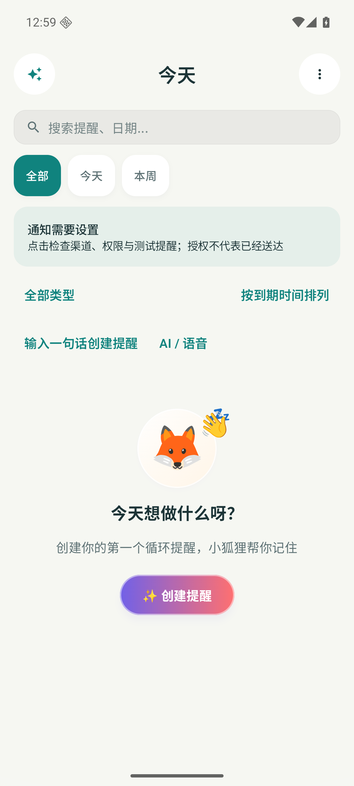
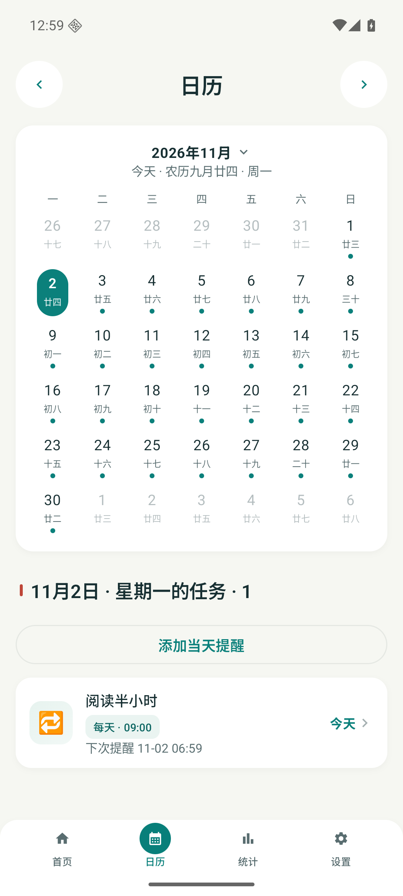
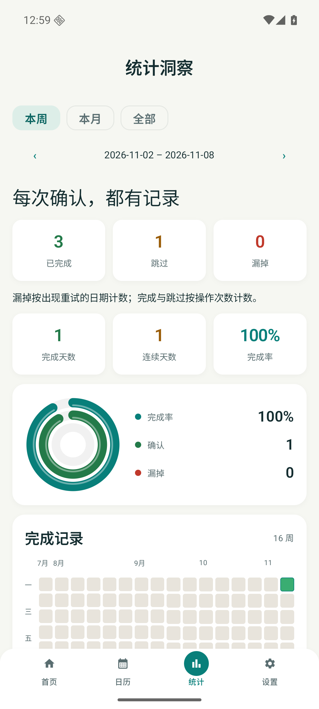
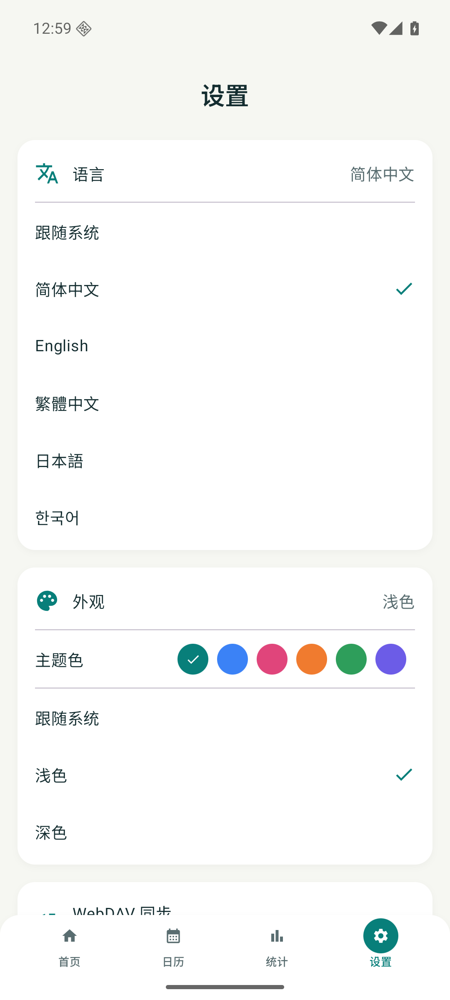

[简体中文](README.md) · [English](README.en.md) · [繁體中文](README.zh-TW.md) · [日本語](README.ja.md) · [한국어](README.ko.md)


# 繰り返しリマインダー

**確認が必要なことを、ひと目で。**

iOS と Android のネイティブ通知アプリ。完了を確認すると次の周期へ進み、未確認なら設定した間隔で再通知します。データは端末に保存し、同期は任意です。

ソース **2.9.0 / 71** · 開発ブランチ、未リリース。公開ダウンロードは Releases を参照してください。

[**ダウンロード・更新履歴 ↗**](https://github.com/tsumon/reminder-app-android/releases/latest) · [別のプラットフォーム](https://github.com/tsumon/reminder-app-ios)

## 主な機能

| 機能 | iOS | Android |
| :--- | :---: | :---: |
| 周期・日付・旧暦誕生日・祝日・第 N 週のルール | ✓ | ✓ |
| 固定周期 / 完了から再計算 | ✓ | ✓ |
| 軽め / 継続 / 重要、再通知とおやすみ時間 | ✓ | ✓ |
| 完了・後で・明日・スキップ・取り消し | ✓ | ✓ |
| 検索・種類の絞り込み・期限 / 名前 / 優先度順 | ✓ | ✓ |
| 当日の予定・週 / 月の統計・ウィジェット | ✓ | ✓ |
| オフライン自然文・音声・テンプレート・任意の AI | ✓ | ✓ |
| JSON・ICS・近くの端末へ転送・ローカル保存・WebDAV | ✓ | ✓ |

## 3 ステップで開始

1. 手入力、自然文、音声またはテンプレートで入力し、編集画面でルール全体を確認します。
2. 通知の強さ、周期の起点、再通知間隔、おやすみ時間を選び、次の 3 回を確認して保存します。
3. ホームから通知診断を開き、権限と設定を確認します。テストを予約し、実機をロックして確認してください。

## 実行画面

実際に動作した画面のみ掲載。サンプルは専用テスト端末のデータで、既定のユーザーデータではありません。

<p align="center">
  
  
</p>
<p align="center">
  
  
</p>

[Create form](docs/screenshots/runtime-2.9/create.png) · [Capture details](docs/screenshots/runtime-2.9/README.md)

## 繰り返しの仕組み

**固定周期**は遅れて完了しても元の予定を維持します。祝日前に移動した通知を早く完了すると、元の周期を消化します。**完了から再計算**は実際の確認時刻を起点にします。既存の設定は維持します。

**軽め**は自動通知 1 回。**継続**の初期値は 60 → 240 → 720 → 1440 分、初回を含め最大 5 回で、各間隔を編集できます。**重要**も OS の権限に従います。再通知はおやすみ時間を守ります。

端末の暦と保存済みの基準タイムスタンプで計算します。時区を変えても既存の時刻は書き換えません。次の通知を確認してください。プレビューは定刻の確認を想定し、休日データで変わる場合があります。

完了とスキップは操作回数、未確認は再通知があった日数を別々に表示します。未確認の記録は通知の実配信を証明しません。

## 同期と復元

自分の WebDAV サーバーを使用します。両端の変更が競合すると選択を待ち、書き込み前に非公開のローカルコピーを保存します。ETag 条件付き更新を維持。v4 は固定 ID で履歴を統合し、削除済みの通知や取り消した記録の復活を防ぐマーカーを保持します。

履歴と削除の完全な同期には両端の更新が必要です。v1–v3 は読み込めますが、旧クライアントは新メタデータを保持しません。ID のない古いファイルでは削除を確実に識別できません。マーカーは失効せず、復元時は新 ID にコピーします。v4 の完全バックアップを保管してください。単体共有カードは全体の削除情報を含みません。

## インストールと上書き更新

Android 8.0+。従来の公開経路の APK を同じパッケージ名と署名のまま上書きします。アンインストールやデータ消去はしないでください。ソースのビルドは正式署名の確認とは異なります。

## 通知状態の意味

権限や予約数は設定状態を示し、配信済みを意味しません。消音、集中モード、通知チャンネル、省電力、メーカーのバックグラウンド制限の影響を受けます。実機のロック中・再起動後・バックグラウンドで確認してください。

Android は AlarmManager を使い、権限があれば正確なアラーム、なければ遅れる可能性がある非正確な方式を使用します。WorkManager は週報などの遅延可能な処理に使います。

## ローカルビルド

JDK 17 · Gradle 8.11.1 · AGP 8.10.1 · SDK 36 · minSdk 26

```sh
./gradlew testDebugUnitTest assembleDebug lintDebug assembleDebugAndroidTest
./gradlew connectedDebugAndroidTest
```

`applicationId / namespace`: `com.reminderapp`

Release: `KEYSTORE_PATH`, `KEYSTORE_PASSWORD`, `KEY_ALIAS`, `KEY_PASSWORD`.

Certificate SHA-256: `0ea509a1dc9461c291a2db47caf5f055d83e4108fb28c3e87ed4fa62bead7038`

## プライバシー

通知と履歴は端末に保存します。AI は設定したサービスへ会話と関連データを送信します。WebDAV・近くへの共有・エクスポートにも通知データを含むため、信頼できる接続先を選び、バックアップを保管してください。

[**検証とプロトコル →**](docs/upgrade-2.9.md) · [Validation](docs/validation-2.9.md)
